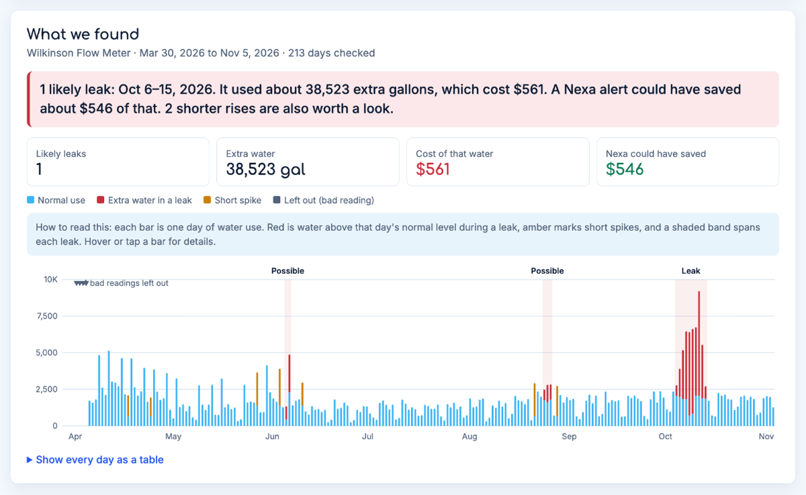
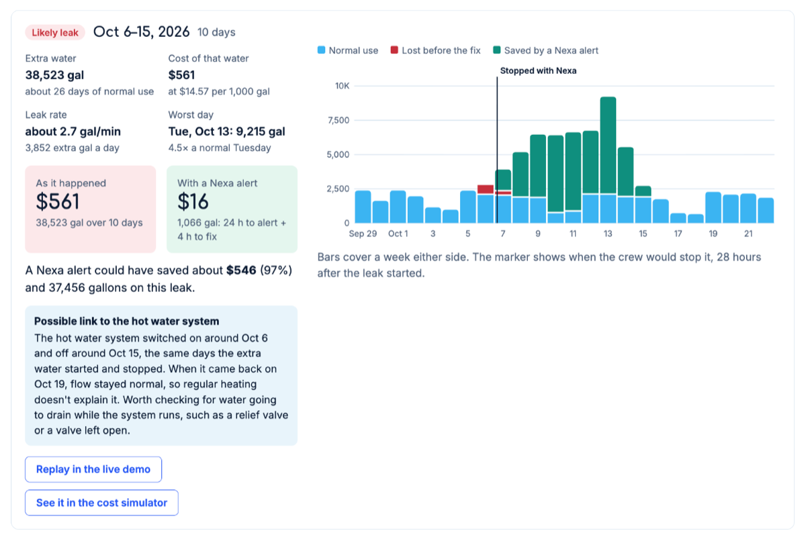
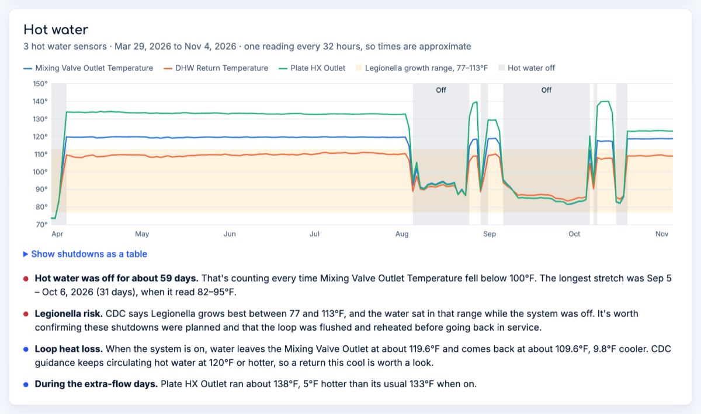
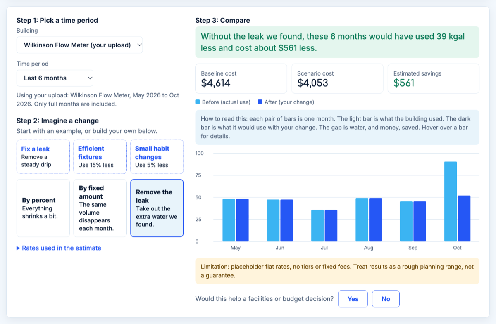
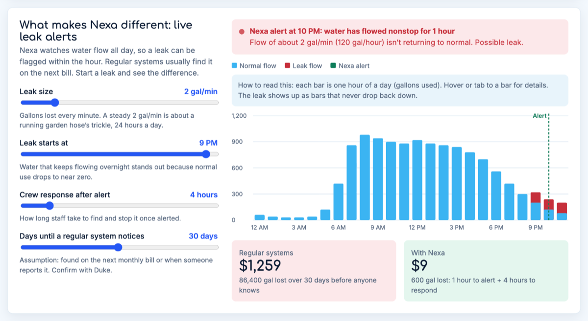

# Nexa water insights

**Find water leaks in a building's sensor data, and see what they cost.**

👉 **Try it now:** https://felixw1020.github.io/nexa-water-insights/ (no sign-up, nothing to install)


## The idea in 30 seconds

Most buildings find out about a leak when the **monthly water bill** arrives. By then, water may have been running for weeks.

Nexa sensors (by Watts) measure water flow **all day, every day**. This site takes the data those sensors export and answers three questions:

1. **Was there a leak?** When did it start and stop?
2. **What did it cost?** In gallons and in dollars.
3. **What if we'd caught it sooner?** How much a Nexa alert could have saved.

It was built for the Nexa pilot at Duke. Everything runs in your browser, and **your files are never uploaded anywhere**.

## A quick tour

The site has three tabs. You can click through all of them with the built-in sample data, so you don't need your own files.

### 1. Your data: upload a sensor export, get the story

Press **"Try the Wilkinson sample"** to load real data from the Wilkinson Building pilot. The site checks every day against what's normal for that building and flags the days that don't fit.



In the sample, the meter shows a **10-day leak in October (Oct 6–15)**. It used about **38,500 extra gallons**, which cost about **$561**. Red shows the extra water. The shaded bands mark each leak.

Each leak gets its own breakdown:



- **Red** = water lost before a crew could fix it, even with an alert.
- **Green** = water a Nexa alert would have saved (here, **97%** of it).
- The site also spotted that the leak lined up with the **hot water system switching on and off**, which points to where to look for the problem.

### 2. Hot water: is it on, and is it safe?

If you add temperature exports, the site also checks the hot water system:



It shows when the hot water was off and how long the water sat between 77°F and 113°F. That's the range where *Legionella*, the bacteria behind Legionnaires' disease, [grows best according to the CDC](https://www.cdc.gov/control-Legionella/php/guidance/monitor-water-guidance.html).

### 3. Cost simulator: "what if?"

Try changes and see what they'd do to the bill. After an upload, it uses your meter's real monthly totals. **"Remove the leak"** shows the bill without the leak.



### 4. Leak simulator: why speed matters

A one-day demo. Start a leak, then compare how much water is lost when a **regular system** finds it on the next bill and when **Nexa** flags it within the hour.



## Words you'll see

| Term | Meaning |
|---|---|
| **gal/min (gpm)** | Gallons per minute. A 2 gpm leak is about a trickling garden hose. |
| **kgal** | 1,000 gallons. Water bills are usually priced per kgal. |
| **Normal use (baseline)** | What this building usually uses on that day of the week. |
| **Likely leak** | Three or more days clearly above normal, or two days at double. |
| **Short spike** | Use jumps for a day or two, then goes back to normal. Often planned work like flushing pipes, so it isn't counted as a leak. |
| **Monnit** | The company that makes the sensors. Exports come from the Nexa dashboard. |

## How it finds a leak, in plain English

1. **Add up each day's water use.**
2. **Work out "normal" for that day.** A Monday is compared with nearby Mondays, because buildings are busier on weekdays than on weekends.
3. **Flag days that are way above normal.** It needs both a big jump (at least 35% more) and a jump that's unusual for this building.
4. **Join flagged days into runs.** One odd day is a spike. Several in a row is a leak.
5. **Price it.** Extra gallons × water and sewer rate.
6. **Imagine Nexa caught it.** Assume an alert after 24 hours and a fix 4 hours later. Water before that point is lost, and the rest is saved. You can change these numbers on the page.

With hourly or finer data, it also checks **overnight flow**. Buildings go quiet at night, so water that never stops flowing is a classic sign of a leak.

<details>
<summary><b>The exact rules</b> (for the curious)</summary>

Each day is compared with the same weekday in the four weeks before and after it. A day is clearly high when it beats that normal level by three times the usual day-to-day swing (a robust measure based on the median, so one bad day doesn't skew it) and by at least 35%. Moderately high neighboring days join the run. A likely leak is three or more days clearly above normal, or two days at double. The days in a leak are then removed and the normal levels are worked out again, so the leak doesn't inflate its own baseline.

Daily totals more than 50 times the meter's typical day are treated as bad readings and left out.

The Nexa estimate assumes the leak starts at the beginning of its first day, the alert fires after the set number of hours, and the crew stops it after the response time. Rates default to placeholders ($6.42 water and $8.15 sewer per 1,000 gallons) with no tiers or fixed fees, so swap in your utility's rates for real numbers.

</details>

## Use your own data

1. Export a CSV from the Nexa dashboard. A flow meter export finds leaks. Hot water temperature exports add context.
2. Open the [site](https://felixw1020.github.io/nexa-water-insights/), go to **Your data**, and drag the files in.
3. Change the alert time, crew response time or water rates, and every number updates.
4. Press **Download daily results (CSV)** to take the day-by-day numbers into Excel.

<details>
<summary><b>File formats it understands</b></summary>

The page is built around Monnit exports: a `timestamp` column and one column per sensor named like `monnit-1265064 (Wilkinson Flow Meter, FlowVolume, gal)`. It also handles:

- Other CSVs with a date column and a flow column (for example `Date, Water use (gal)`), including semicolon-separated files.
- Daily, hourly or 10-minute readings.
- Gallons, kgal, liters, cubic meters, cubic feet and ccf, or flow rates in gpm or L/min.
- Running meter totals (like a car's odometer), which are converted to use per reading.
- Temperatures in °F or °C.
- US (month/day) or day/month dates.
- The same sensor in several files. Repeated readings count once, and if the files use different time steps, the most detailed one wins.

</details>

## For developers

The whole app is one file with no build step. Open `index.html` in a browser and it works.

```
index.html        the whole app: styles, analysis engine, UI, embedded sample
sample-data/      Wilkinson flow (daily) and hot water temperature exports
tests/            tests for the analysis engine
docs/images/      screenshots used in this README
```

The analysis code lives in the `<script id="nexa-engine">` block. It has no DOM code, so the tests can run it in Node.

**Run the tests** (Node 18 or newer, no `npm install` needed):

```
node tests/engine.test.mjs
```

They run the engine on the Wilkinson sample and on made-up data: 10-minute readings with a 181-hour leak, a small overnight leak, running totals, gpm, Celsius, semicolon files, day/month dates and duplicate files. They also check that the sample embedded in the page matches `sample-data/`.

**Deploying:** the site is served by GitHub Pages from the `main` branch. Push to `main` and it updates in about a minute.

## Notes

- The sample is real sensor data from the Wilkinson Building pilot (Mar 30 to Nov 5, 2026). Check with Duke Facilities and Watts that it can be shared publicly.
- Times are shown as written in the file.
- All dollar figures are estimates, not a bill.
